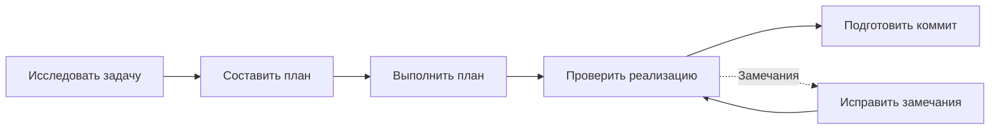
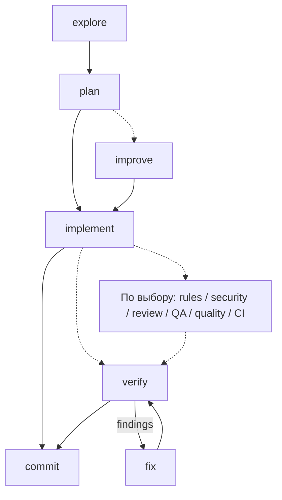
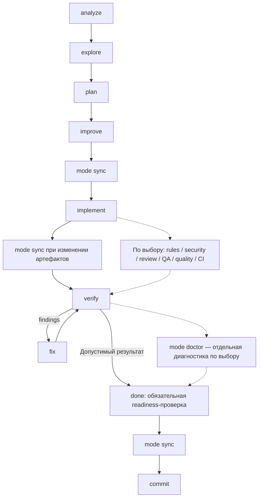

# Workflow и источники статуса

[README](../README.md) · [Настройки и CLI](reference.md)

Плагин предлагает переходы по установленным skills и фактическому формату артефактов. Правила проекта, контракты AI Factory/AIFHub, точные handoff и обязательные gates сохраняют приоритет. Кнопка ведёт к владельцу действия и не разрешает автоматически всю цепочку.

## Вкладка: «Навигация» и «Настройки»

Постоянная вкладка AI Factory разделена переключателем **Навигация | Настройки** в закреплённой шапке; выбор запоминается для чата на сессию браузера (sessionStorage). На узкой панели (ширина контейнера меньше 448 px) переключатель переносится второй строкой шапки на всю ширину двумя равными половинами. «Навигация» — текущая работа: предупреждение «Проект не подготовлен к AI Factory» с кнопкой **Подготовить** (переход в «Настройки» к блоку подготовки), пока не выполнены основные шаги `install`, `context`, `architecture` (`readinessCoreComplete`), «Сейчас», «В работе» (дочерние треды исполнителей и разведчиков — только когда они есть) и «Что проверить». «Настройки» — то, что задаётся один раз: «Подготовка проекта» (первой, с рамкой акцентного цвета, пока не выполнены основные шаги), «Исполнители», «Оценка кнопок» (строка «Gemini Decisions» с подписью), «Модели по умолчанию для новых проектов», «Настройка инструментов», «Другие команды» и «Версии и расширения» со строкой версий CLI, проекта и Git. Точка на «Настройки» означает ошибку конфигурации, доступное обновление или невыполненные основные шаги подготовки. Карточки в переписке без переключателя и не изменились.

Секции панели собраны группированным списком: мелкий серый заголовок группы над блоком без рамки, строки разделены линиями; вложенные рамки внутри секций убраны. Этот стиль действует только во вкладке — карточки в сообщениях сохраняют прежнюю вёрстку. В «Подготовке проекта» шаг запускается стрелкой **›** справа в строке, а нажатие на название (или «?») раскрывает описание и кнопки «Пропустить»/«Вернуть»; отдельных кнопок запуска в строке нет. В «Исполнителях» вся строка роли — кнопка «Изменить»: название, модель с уровнем рассуждения второй строкой и «›» справа; «?» стоит сразу после названия роли и не открывает редактор.

«Исполнители» — четыре строки (Код, Разведчик 1, 2, 3); вся строка — кнопка, раскрывающая редактор «Этот агент / Другая модель» с пояснениями под «?». «Модели по умолчанию для новых проектов» хранятся в `bb.storage.kv` (`delegation-defaults`) — общие для всех проектов и машин этого BB; кнопки «Взять из этого проекта», «Применить к этому проекту», «Очистить». В проекте с настроенным AI Factory, где все четыре роли — «Этот агент», умолчания применяются один раз теми же файлами, что ручное сохранение (`.ai-factory.json` → `phases.implement` и блоки skill-context); проект помечается `delegation-defaults-applied:<hostId>:<path>`, повторного применения нет, ручное сохранение любой роли тоже ставит отметку, чужой `phases.implement` не трогается — применяются только разведчики. Автоприменение оставляет некоммиченные изменения в репозитории проекта.

## Режим AI Factory в поле ввода

Кнопка со значком «завод» в поле ввода (во включённом состоянии — оранжевая заливка с белым значком, не цвета темы) (области `new-thread` и `thread`) включает режим для проекта. Состояние хранится в SQLite плагина (`project_modes`), чтение синхронное — его выполняет `bb.agents.configure` на каждом `thread.start`/`turn.submit`.

- **Инструкции.** При включённом режиме и `enabled` плагина `configure` добавляет агенту текст `aifModeInstructions()`: читать `.ai-factory/DESCRIPTION.md` и `ARCHITECTURE.md` (пути — из `config.yaml`), вести работу `/aif-plan` → `/aif-implement` → `/aif-verify` → `/aif-commit` (`/aif-fix` для багов), соблюдать `.ai-factory/skill-context/`, вызывать `aif_chat_status` на границах этапов. Дочерним тредам (`parentThreadId !== null`) инструкции не добавляются — это исполнители и разведчики со своим брифом.
- **Ограничение F2.** Изменённые инструкции не попадают в уже запущенную сессию ни у одного провайдера: они применяются при следующей сборке сессии (новый тред, возобновление после рестарта демона). Поэтому включение режима в идущем чате сопровождается пилюлей.
- **Пилюля.** Упоминание-провайдер `aif-mode` (`@AI Factory`) вставляется в черновик, когда сервер ставит флаг `kv aif-pill:<threadId>`: при включении режима в треде с хотя бы одним `client/turn/requested` и при событии `thread/compacted`. `resolve()` отдаёт агенту тот же текст режима как `agent-only` контекст при отправке (F4). Клиент вставляет пилюлю один раз и подтверждает `ackAifPill`; выключение режима удаляет её из черновика. Пилюля безвредна и там, где инструкции не терялись.
- **Компакция (F3).** `experimental_thread.events` отслеживает треды: курсор `kv aif-events-cursor:<threadId>` ставится на текущий `sequence` при первой встрече (история не перечитывается); более поздний `sequence` запускает чтение `thread/compacted` после курсора. Claude Code и Codex держат инструкции в настройках сессии и после компакта их сохраняют; ACP-провайдеры передают инструкции текстом первого промпта — агент может сжать их при компакте, и BB их заново не добавляет. Поэтому пилюля ставится для всех провайдеров.
- **Проект без AI Factory.** В области `thread` при `configured === false` кнопка не включает режим, а открывает вкладку AI Factory. В `new-thread` окружения ещё нет — проверка не делается; без выбранного проекта кнопка неактивна.
- **Подсказки.** Если в последнем ответе агента нет команд AI Factory и ответ пуст без gate/ошибки, при включённом режиме показываются до 3 доступных действий группы `next` с причиной «Следующий шаг». Подсказки из ответа агента приоритетнее.
- **Модель исполнителя.** Для каждого дочернего треда читаются последнее `client/turn/requested.data.execution` (запрошенные модель и уровень — F7) и `provider/modelFallback` после него. Подпись «Провайдер · модель · уровень · статус»; «⚠ Подмена: A → B (причина)» — только при событии fallback, которое пишет один Claude Code (F8): у Codex и ACP тихая подмена провайдера BB не видит. «⚠ Ожидалась модель …» — когда тред `AIF · …` или `AIF research · …` запущен не на модели, выбранной в «Исполнителях». Результат кэшируется по `childId + updatedAt`; ошибки чтения событий обнуляют поля без падения панели.

## Подсказки команд и оценка кнопок

Чипы над полем ввода собираются из последнего ответа агента: имена `$aif…`/`/aif…` и команды, написанные целиком в inline code. Команда из code span сохраняет аргументы (одна строка, до 300 символов); из обычного текста берётся только имя — аргументы отбрасываются, кроме фиксированной `aif-mode sync`. На одну команду — один чип: вариант с аргументами важнее голого. Чипы неустановленных skills не показываются, кроме `suggested_next` из gate — он авторитетен и остаётся тусклым с причиной.

Нажатие на чип с аргументами при пустом поле отправляет команду сразу; голые `aif-explore`/`aif-plan`/`aif-fix` ждут тему. При непустом поле команда с аргументами встаёт первой строкой (заменяя её, если она начинается с команды) без отправки; пилюля режима AI Factory в черновик-команду не добавляется — BB передал бы её текст skill как аргументы.

**Оценка кнопок** выключена по умолчанию и включается в «Настройках» → «Оценка кнопок». При двух и более доступных командах сервер один раз на ответ агента (ключ — `sourceKey` + набор id, результат кэшируется) отправляет в Google Gemini Decisions API (`gemini-decision-1`) запрос с вопросом `choice`: в `input` идёт последний ответ агента, обрезанный до 20 000 символов, в `criteria` — id и текст команд-кандидатов. Ответ разбирается zod-схемой, вероятности проставляются чипам; кнопки сортируются по убыванию, у вероятнейшей — акцентная рамка. Таймаут запроса — 15 с, параллельных запросов на один ключ нет; ошибка кэшируется без повторов для того же набора, причина видна в «Настройках».

Ключ API выбирается источником «Из Env Catalog» или «Ввести вручную». Из каталога хранится только имя записи; значение читается перед каждым запросом через RPC `env_get_value` плагина env-catalog (таймаут 5 с), список имён — через `env_list`. Если env-catalog не установлен, остаётся только ручной ввод — секретная настройка плагина `decisionsKey` (файл 0600, значение никогда не отправляется во вкладку). Чтения env-catalog пишутся в журнал aif-chat только по имени ключа; значение ключа и текст ответа в журнал не попадают.

## Параллельное выполнение задач плана

Опциональный режим делегирования кода: у роли **Код** при «Другая модель» в «Исполнителях» появляется переключатель **Параллельно** (Выкл · 2 · 3 · 4). Хранится как query-параметр `parallel=2..4` в `phases.implement.model` рядом с `reasoning`/`tier`, поэтому переживает `ai-factory update`; при «Этот агент» и у ролей разведки параметра нет. Параллельный расчёт работает только для AI Factory-планов — встроенный flow `.bb-aif-helper/plans/` и OpenSpec change идут последовательно.

**Группы считает код, а не агент.** Чистый модуль `parallel-plan.ts` разбирает раздел `## Tasks` плана: `Task N:`, `Depends on` (явный список `2, 4`, диапазон `1-3`, `none`/`—`; без явной записи задача зависит от всех задач предыдущих фаз `###`), `Files:` (конкретные пути в обратных кавычках; glob, `перечисленные` или пустой список считаются неясными). Отмеченные `[x]` задачи удовлетворяют зависимости. Дальше задачи упаковываются в группы по правилам:

- группа не больше выбранного максимума (2–4);
- две задачи с пересекающимися файлами (тот же путь или общий префикс каталога) в одну группу не попадают — вторая уходит в следующую;
- задача без понятного `Files:` идёт одна;
- задачи с маркером `<!-- aif:task-kind:commit -->` и задачи выкатки (`deploy`, `publish`, `release`, `push`) идут одни и только координатором — в ответе CLI они перечислены отдельно как `coordinatorOnly`;
- цикл в зависимостях, ссылка на несуществующую задачу, ultra-бандл или пустой список задач дают `{ error }` — координатор работает последовательно.

Расчёт доступен детерминированной командой `bb plugin run aif-chat groups --target <план> [--max N] [--json]`: печатает `Группа 1: задачи 5, 7`, строку «Только координатор: …» и в `--json` отдаёт `{ groups, coordinatorOnly }` или `{ error }`. Именно её вызывает координатор из управляемого блока делегирования.

**Как идёт выполнение.** Перед каждой группой из двух и более задач `git status --porcelain` должен показывать только собственные изменения плана: чужие незакоммиченные файлы — стоп и вопрос владельцу, чужое не коммитится. Затем координатор делает локальную контрольную точку `chore(aif): <план> · before group N` без push — копии строятся из коммита и не видят незакоммиченной работы. Каждую задачу группы он запускает отдельным дочерним тредом `AIF · <план> · <taskId>` в собственной git worktree-копии от этого коммита: координатор создаёт её сам — `git worktree add --detach "$BB_THREAD_STORAGE/tmp/aif-wt-<план>-<taskId>" refs/heads/<текущая ветка>` — и запускает исполнителя с `--environment <копия>`. Так режим работает и там, где папка проекта BB не git-репозиторий (BB сам создать worktree в ней не может: `HTTP 409 … no usable git branch`) (неотслеживаемые файлы вроде `node_modules/` не копируются — исполнитель ставит зависимости сам командой установки из каталога команд проекта и не коммитит). После завершения всех исполнителей группы координатор переносит результат по одному: в копии `git add -A` и `git diff --cached --binary HEAD` в patch-файл, в основной папке `git apply --3way`, затем просмотр diff и проверка задачи. Конфликт или ошибка применения — откат этого патча, стоп и отчёт владельцу с конфликтующими файлами. Задача отмечается выполненной только после применённого и проверенного патча; тред исполнителя архивируется, копия удаляется `git worktree remove --force <копия>`. Локальные контрольные точки остаются частью итоговых коммитов плана и не пушатся без одобрения владельца.

В «В работе» дочерний тред, чья среда — отдельная worktree-копия, помечен бейджем **«отдельная копия»**.

**Когда не ускоряет.** Задачи с общими файлами, явными зависимостями или коротким объёмом идут по очереди; каждая группа всё равно стоит spawn + ожидание + перенос патча, а группа из одной задачи работает по обычному одноисполнительному сценарию. Если `git worktree add` или `bb thread spawn` не сработали, остаток плана выполняется последовательно.

**Правило для планировщика.** При включённом параллельном режиме плагин записывает управляемый блок в `.ai-factory/skill-context/aif-plan/SKILL.md` (между маркерами `bb-aif-helper:plan`): у каждой задачи плана должны быть `Files:` с конкретными путями и `Depends on`; задачи с общими файлами — зависимыми или объединёнными, коммит и выкатка — последними. При выключении переключателя блок удаляется.

## Без установленного AI Factory

Если проект не инициализирован и профиль `none`, панель предлагает установку AI Factory и самостоятельный базовый workflow:

Это встроенные инструкции текущему агенту, а не вызовы неустановленных `aif-*`. Промпт исследования написан по принципам [upstream aif-explore](https://github.com/lee-to/ai-factory/blob/2.x/skills/aif-explore/SKILL.md): чтение действующего проекта, уточнение действительно неизвестных решений, сравнение вариантов, факты/риски/неизвестное и остановка до реализации. Промпт включён в пакет плагина; обращения к репозиторию или установка AI Factory при исследовании не требуются.

- **Исследовать задачу** — изучает код и требования, результат остаётся в чате.
- **Составить план** — создаёт `.bb-aif-helper/plans/<slug>.md`: цель, ограничения, `## Tasks` с нумерованными `- [ ]` задачами и `## Проверки`. Уточнение сохраняет уже выполненные пункты. Плагин сам не переключает режим планирования провайдера; используется файловый план с соблюдением ограничений текущего режима.
- **Выполнить/продолжить план** — предлагается для выбранного плана с задачами. Агент выполняет задачи и отмечает фактический прогресс; несколько планов требуют явного выбора, случайный файл не подставляется.
- **Проверить реализацию** — сопоставляет код с планом и запускает подходящие существующие проверки. Проблемы, NOTRUN и UNKNOWN сообщаются отдельно. Чекбоксы не означают PASS.
- **Подготовить коммит** — предлагается при незакоммиченных файлах Git, с просмотром diff и сохранением несвязанных изменений. Открытие панели не создаёт коммит.

Все шаги запускаются отдельным нажатием и сохраняют guards занятости, вопросов, повторной/неопределённой доставки и блокирующего gate. План и progress читает плагин; файлы и код по выбранному действию меняет агент. Встроенные шаги не устанавливают CLI/skills, не придумывают AI Factory QA reports и не выдают себя за AIFHub readiness.

**Установить AI Factory** — отдельная maintenance-кнопка. По нажатию агент проверяет имеющийся CLI и менеджер установки, при отсутствии CLI использует официальный способ установки (например, `npm install -g ai-factory`), затем инициализирует проект для поддерживаемого текущего runtime (`ai-factory init --agents codex-app --skills all` для Codex app). Linked/source установка и пользовательские файлы сохраняются; MCP и расширения не добавляются без отдельного выбора. Результат подтверждается metadata и существующими skills.

После успешной установки карточка освобождает только выбор базового плана и переключается на установленные действия. Markdown-файлы сохраняются; автоматического переноса в AI Factory/OpenSpec нет. Ошибочная существующая конфигурация с профилем `invalid` сохраняет ограниченный режим восстановления, а не обходится базовым flow.

## AI Factory upstream

В upstream improve/verify могут быть необязательными; требования проекта продолжают действовать. После explore доступны планирование и отдельный fix для исследованного дефекта. Сам `aif-fix` определяет допустимый режим fix-now/plan-first.

После подготовки плана предлагаются улучшение и выполнение. По мере реализации читаются чекбоксы. Завершённые задачи позволяют предложить verify или подготовку коммита, но не доказывают готовность к публикации.

Независимо от этапа, при подтверждённых незакоммиченных файлах текущего проекта первой предлагается **Подготовить коммит**. Это работает и без активного плана после архивации, и при нескольких кандидатах плана. Читается Git status рабочей папки, а не флаг изменения настроенного sourceRepo AI Factory: учитываются staged, unstaged и неигнорируемые untracked files. Чистый status или недоступный Git не создают это дополнительное предложение; существующие переходы к commit по этапу сохраняются. Некорректная конфигурация и отсутствие skill продолжают ограничивать доступность.

Кнопка не выбирает все грязные файлы в состав коммита. Владелец aif-commit сначала читает правила/status/diff и определяет scope; несвязанные изменения сохраняются. Перед отправкой запроса сервер перечитывает файлы, проверяет занятость, вопросы и последний блокирующий gate. Коммит и push не запускаются открытием панели.

## AIFHub classic и OpenSpec

Основные владельцы действий: explore → plan → improve → implement → verify → проверка готовности → done. Необходимые синхронизации артефактов и условия перехода определяет установленный AIFHub; это не полный перечень внутренних шагов skills.

Для OpenSpec полный маршрут и дополнительные ветви:

Пунктир обозначает необязательную ветвь навигации, а не отмену требований проекта. Выбирается одна или несколько подходящих проверок; они не запускаются пакетом или автоматически. Если политика требует конкретный gate, он обязателен перед завершением. Отдельный doctor необязателен, но readiness внутри done сохраняется. Sync-переходы показаны как контракт workflow; плагин пока не выделяет pre-implement sync отдельной основной кнопкой.

После plan предлагается improve. Новый баг без findings идёт через plan. При подтверждённых замечаниях используется fix → verify. Неблокирующий WARN сам по себе не создаёт лишний fix-loop.

После отчёта verify с PASS или неблокирующим WARN может быть предложен `aif-done`: финализатор заново проверяет готовность, обязательные evidence и актуальность. Это не утверждение, что done уже прошёл. Синхронизация и подготовка коммита выполняются отдельно.

В OpenSpec выбирается canonical `tasks.md` change; rules проверяются для выбранного change. Fast-план в проекте с AIFHub может делегироваться upstream. Выбор `aif-analyze` для настройки контекста всё равно определяется установленным расширением, независимо от профиля плана.

## Legacy ultra

Legacy ultra имеет отдельный маршрут с index ledger и receipt. Он не смешивается с classic-артефактами и обычной финализацией. Проверка receipt передаётся владельцу `aif-done`, который должен сохранить точный handoff к verify/archive. Наличие каталога само по себе не доказывает валидность ultra.

## Источники

- **CLI** — metadata пакета рядом с найденным в PATH shim; сам shim для версии не запускается.
- **Проект** — `.ai-factory.json`; неизвестная версия не подменяется глобальной.
- **Git** — настроенный `sourceRepo`, его HEAD и рабочее дерево.
- **GitHub** — upstream/ref по явному запросу, с SHA и временем проверки.
- **Расширения** — записи проекта и установленные manifests; extension JS при чтении не импортируется.
- **Навыки** — зарегистрированные базовые/custom skills с существующими `SKILL.md`.
- **Задачи** — чекбоксы canonical plan, `index.md` или OpenSpec `tasks.md`; примеры кода и комментарии не считаются задачами.
- **Занятость/вопросы** — текущее состояние чата BB.
- **Этап** — объявленное агентом или через `show` значение; не эвристика по тексту команд и времени файлов.

## Проверки и QA

Секция **Что проверить** разделяет verify, rules, security, review, QA-сценарии, результаты QA, а при установленном AIFHub — coverage и done readiness. Quality/CI требуют фактических подходящих проекту проверок, а не файлов конфигурации.

### Дополнительные шаги flow

| Проверка | Когда полезна | Команда кнопки | Что подтверждает |
| --- | --- | --- | --- |
| Правила проекта | После изменений, перед verify/commit/done | `/aif-rules-check` | Соблюдение правил; в OpenSpec scope привязан к выбранному change |
| Безопасность | После изменений, затрагивающих безопасность, перед завершением | `/aif-security-checklist` | Результат security gate в проверенном scope |
| Code review | После реализации или исправлений | `/aif-review` | Findings и итог review |
| QA-сценарии | Когда понятны изменения и пользовательские сценарии | `/aif-qa` | Подготовку сценариев, без утверждения об их прохождении |
| Прохождение QA | После подготовки сценариев | `/aif-qa-check` | Фактические результаты выбранных сценариев |
| Качество кода | При подготовке проверок или перед завершением | `/aif-quality-setup audit` | Аудит существующих lint/types/tests/build; сам аудит не означает их успешный запуск |
| CI | Когда существует run для нужного commit | `/aif-chat ci` | Статус существующего run нужного SHA; без запуска/retry или создания pipeline |
| Конфигурация и артефакты | В OpenSpec перед реализацией или завершением, при проблемах режима | `/aif-mode doctor --change "<id>"` | Read-only диагностику выбранного change; без sync/init/исправлений |

В Codex кнопки используют `$` вместо `/`. Все эти действия находятся в секции **Что проверить**, рядом со своей строкой. Дополнительные строки помечены **по выбору**; распознанное требование политики заменяет эту подпись на **нужно для завершения**. Это не полный анализ всех правил проекта: отсутствие такой пометки не отменяет требований установленного skill или проекта.

Пропуск необязательной проверки сам по себе не создаёт FAIL и не останавливает основной маршрут. Уже полученный блокирующий FAIL, напротив, сохраняет силу: исправление → повторная проверка. Coverage и done readiness остаются отдельными артефактами/обязанностями владельцев; им не придумывается самостоятельная команда или необязательный статус.

Начиная с 0.3.1 завершённый `aif-gate-result` из истории чата показывается как **WARN/PASS/FAIL · из чата** с датой, номером сообщения, blockers и причиной рекомендации. Он привязывается к плану только по точному canonical path в `affected_files` либо предшествующем запросе запуска. Результаты разных gates сохраняются независимо: новый rules не стирает verify. Запись из чата и наличие файлового отчёта показаны отдельно; история не подтверждает актуальность результата для текущих файлов и не меняет готовность workflow автоматически.

Чтение ограничено последними 600 событиями завершения items/запросов запуска, страницами по 100, с кэшем 15 секунд и обновлением на границах работы агента. Найденные результаты сохраняются в хранилище плагина по чату, рабочей среде, хосту и корню проекта. Если старый gate находится за пределами окна и раньше не был обнаружен, он не будет отмечен. Неоднозначная привязка, prose PASS, вложенные tool messages и повреждённые gates не засчитываются.

- **Не запускалась** (`notrun`) — отчёт проверки не найден; факт прежнего запуска неизвестен.
- **PASS в отчёте** (`reported-pass`) — валидный gate block содержит PASS; актуальность для текущих входных данных отдельно не подтверждена.
- **С замечаниями** (`warn`) — отчёт содержит WARN.
- **Ошибка** (`fail`) — отчёт содержит FAIL или распознанный блокирующий результат.
- **Не подтверждено** (`unknown`) — основания для результата недостаточны; например, файл есть, но валидного gate block нет.

Для gates читается последний валидный блок `aif-gate-result` нужного типа. Галочка плана, старый PASS, подготовленные QA-сценарии или pipeline не дают актуального зелёного результата.

**Качество кода** запрашивает read-only аудит существующих инструментов стека. Настройка проверок/CI вынесена отдельно. **Посмотреть CI** проверяет существующий run нужного SHA, без генерации pipeline и его запуска.

## Повторные проверки

Кнопки находятся прямо в строках проверок. Для verify/rules/security/review после живого завершения валидного gate плагин фиксирует состояние Git и прочитанных metadata выбранного плана. Пока оно совпадает с текущим, кнопка отключена с подписью **без изменений**. Это относится и к повторной команде из предложений, и к дублирующей кнопке verify над списком. После изменения файлов кнопки снова доступны; сервер сравнивает актуальное состояние непосредственно перед отправкой.

Отпечаток включает HEAD, branch, index, diff/status, установку/runtime, canonical plan, прочитанные metadata и байты неигнорируемых untracked files. Этап, часы и занятость чата не считаются изменением файлов. Неигнорируемые новые файлы ограничены 200 файлами, 1 MiB на файл и 32 MiB суммарно; Git output — 1 MiB. Другие игнорируемые файлы вне прочитанных metadata не входят в сравнение. Если Git/чтение недоступны, обнаружены submodules или превышен лимит, повтор остаётся доступным.

Состояние фиксируется только на событии завершения текущего ответа и связывается с конкретным gate/планом/средой. Старый результат, загруженный из истории, не получает отпечаток сегодняшних файлов. Перезагрузка не меняет сохранённую привязку. Неизвестные результаты, QA/quality/CI без подходящего структурированного gate не блокируются этим правилом. Действия coverage/readiness не придумываются при отсутствии подходящего owner-действия.

Подпись **без изменений** означает совпадение с состоянием при фиксации результата, а не доказательство свежего PASS. При необходимости пользователь может отдельно запросить повторную проверку в чате.

## Кэш и обновление

Снимки файлов сохраняются в SQLite-базе самого плагина и в памяти. Ключ включает рабочую среду, корень/хост, цель, runtime и настройки источников. Разные этапы карточек используют одно чтение файлов, но получают свои действия и phase; состояние чата, вопросы и gate-история добавляются отдельно. Параллельные запросы к одному снимку объединяются.

Обычное чтение использует память до 60 секунд. После истечения срока карточка сразу получает предыдущие данные, пока идёт одно фоновое обновление. После reload сохранённый снимок также показывается сразу и обязательно сверяется в фоне. Максимум — 100 снимков по 1 MiB; снимки старше 24 часов требуют полного чтения. Время внизу относится к сбору данных, а не к моменту открытия карточки. Фоновая ошибка оставляет сохранённые данные с предупреждением и 15-секундной задержкой перед повтором.

**Без опроса.** UI читает `status`, `suggestions`, `delegation`, `aifMode` и `chipScoring` через `experimental_useRpcQuery`: общий кэш BB объединяет одинаковые запросы всех карточек, держит ответ свежим 2 секунды и сам ничего не перечитывает по таймеру. У каждого чтения есть тег (`thread:<id>`, `project:<id>`, `chip-scoring`); сервер помечает тег устаревшим через `bb.rpc.experimental_invalidate`, и BB сразу перечитывает только эти данные. Поводы: события `thread.active/idle/failed` треда и его родителя, компакт, действия панели, новый результат кэша снимков (только если содержимое снимка изменилось, без учёта `collectedAt`) и изменения файлов.

**Наблюдатель файлов.** Пока хоть одна карточка или вкладка держит чтение `status` (`experimental_whileWatched`), хост ставит один нативный наблюдатель BB на корень проекта (без `node_modules`, `.git`, `dist`, `build`, `.next`, `coverage`, `.bb`; задержка 300 мс, не дольше 1 с). Сигнал на сервер уходит только для служебных путей: верхние папки и файлы с точкой (`.ai-factory/`, `.github/`, `.ai-factory.json`), корневые файлы `md/yml/yaml/json/toml` и сборочные (`Makefile`, `Dockerfile`, …), всё под `docs/` и `openspec/`. Сервер сбрасывает снимки этого корня и помечает устаревшими треды, которые его показывают. `rescan-required` даёт одно обновление; `watch-error` или падение воркера хоста — одно обновление и одну повторную постановку наблюдателя; при второй ошибке подряд наблюдатель не ставится до следующего открытия карточки, а данные продолжают обновляться по событиям треда. Резервного таймера нет. Когда последняя карточка закрыта, наблюдатель снимается.

**↻** отправляет `force: true` и запускает новое чтение без кэша. То же правило действует для CLI/agent status и перед отправкой workflow-команды; ошибка принудительного чтения не заменяется кэшированным успехом. Окончание работы агента помечает снимки среды для обновления. Занятость и вопросы читаются при каждом запросе. Автоматического GitHub version check, запуска модели или workflow для обновления кэша нет.

История gates сверяется не чаще раза в минуту в обычном отображении и сразу при принудительной проверке/границе workflow. Сохранённые результаты доступны до завершения сверки. Старые завершения фонового запроса не должны перезаписать более свежие данные после invalidation или reload.

## Версии и размещение обновления

Для версий CLI и настроенного Git checkout действует отдельный кэш 24 часа. Обычный refresh/force перечитывает задачи, проверки, конфигурацию и установленные extension manifests, но не запускает заново CLI/source version probes. В разделе версий показано время снимка. Прочитанные для workflow metadata дают текущую проектную и установленную версию расширений без внешних запросов. При явном обновлении через maintenance локальный version-кэш инвалидируется; завершающий status показывает новый CLI/checkout.

Проверка GitHub запускается по соответствующей кнопке или `check-updates`. Сохранённая попытка ограничивает запросы одного host/repo/ref одним разом за 24 часа. Попытка резервируется до обращения к хосту, поэтому ошибки, параллельные запросы, force и reload не обходят ограничение. Кнопка показывает следующую доступную дату. Обычное чтение панели не начинает сетевую проверку расширений или GitHub.

Если CLI и версия проекта известны и совпадают со всеми известными Git/worktree/upstream версиями, кнопка обновления AI Factory остаётся доступной внутри «Версии и расширения». При неизвестной локальной версии или расхождении она видна наверху. Кнопка расширений перемещается внутрь только при совпадающем ядре и здоровых extensions с одинаковыми recorded/installed версиями. Setup-команда находится наверху до начала выполнения плана, затем под «Настройка контекста проекта». Это размещение по имеющимся версиям, а не утверждение о проверенном отсутствии новых релизов при неизвестном upstream.

## Границы автоматизации

Открытие панели и чтение статуса не запускают навыки, тесты, обновления или модель. Явная проверка версии обращается к GitHub. После нажатия workflow-кнопки запрос исполняет текущий агент с обычными полномочиями BB и лимитами выбранного провайдера.

Плагин не проставляет задачи, не пишет evidence, не архивирует планы и не публикует изменения самостоятельно. Недостающие receipts, legacy-структуры и противоречивые metadata показываются как ограничения. Автоматическая миграция отсутствует.
